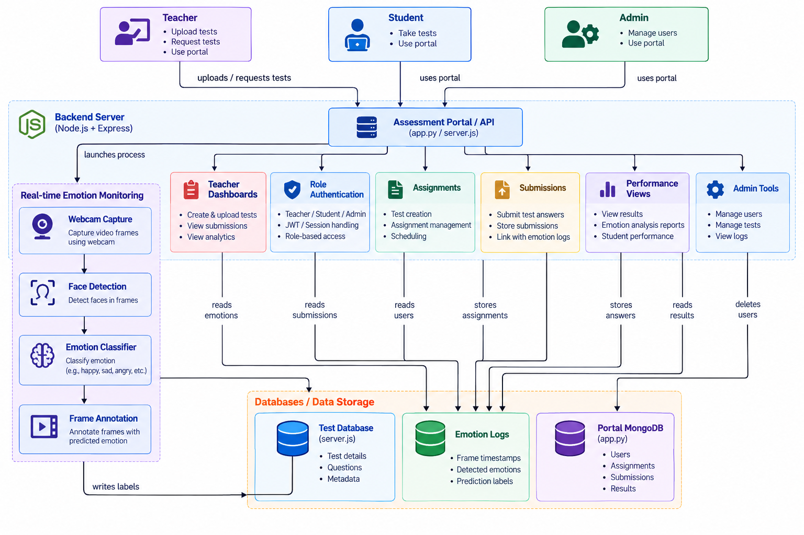

# Real-Time Emotion Detection in Online Assessments (EMVI)

An AI-assisted online assessment platform that combines role-based assessment management with real-time facial emotion analysis. The system is designed to help teachers review assessment activity and emotion-related signals during online tests.

> **Project note:** Facial expressions are model predictions, not definitive measures of a student's feelings, understanding, honesty, or performance. Results should be interpreted cautiously and should not be used as the sole basis for high-stakes decisions.

## Table of Contents

- [Overview](#overview)
- [Key Features](#key-features)
- [System Architecture](#system-architecture)
- [Technology Stack](#technology-stack)
- [Project Workflow](#project-workflow)
- [Getting Started](#getting-started)
- [Configuration](#configuration)
- [Privacy and Responsible Use](#privacy-and-responsible-use)
- [Limitations and Future Improvements](#limitations-and-future-improvements)
- [Author](#author)

## Overview

Online assessments make it difficult for teachers to observe students' non-verbal responses in the same way they might in a physical classroom. EMVI explores a computer-vision-based approach to processing webcam frames and associating predicted facial expressions with assessment activity.

The platform is organized around three roles:

- **Teacher:** creates or uploads tests, reviews submissions, and views analytics.
- **Student:** accesses the portal and takes assigned tests.
- **Admin:** manages users, tests, and administrative tools.

The real-time emotion pipeline captures webcam frames, detects faces, classifies facial expressions, and annotates frames with predicted labels. Assessment data and emotion-related logs are represented as separate storage components in the architecture.

## Key Features

- **Role-based access:** separate teacher, student, and administrator workflows.
- **Assessment management:** test creation, assignment scheduling, and submission handling.
- **Webcam-based frame capture:** processes frames from a student's webcam when camera access is enabled.
- **Face detection:** locates faces in captured frames before emotion classification.
- **Emotion classification:** predicts an expression category from a detected face.
- **Frame annotation:** associates frames with predicted emotion labels.
- **Teacher dashboards:** provides views for submissions, analytics, and emotion-related reports.
- **Administrative tools:** supports user and test management and log review.
- **Data separation:** distinguishes test information, emotion logs, and portal records in the system design.

## System Architecture

The diagram below is the **original architecture image supplied for this project**. It is included as an image file and has not been redrawn.



### Architecture components

| Component | Responsibility |
|---|---|
| Teacher, Student, Admin | Access the assessment portal according to their roles. |
| Assessment Portal / API | Coordinates portal requests and assessment-related operations. |
| Backend Server | Supports application-side processing and communication between portal components. |
| Real-time Emotion Monitoring | Captures webcam frames, detects faces, classifies expressions, and annotates frames. |
| Teacher Dashboards | Supports test management, submission review, and analytics. |
| Role Authentication | Represents session handling and role-based access control. |
| Assignments and Submissions | Handles assessment setup, answer submission, and related records. |
| Performance Views | Presents results and emotion-analysis reports. |
| Admin Tools | Supports user management, test administration, and log review. |
| Test Database, Emotion Logs, Portal MongoDB | Represent test metadata, predicted emotion records, and portal records respectively. |

## Technology Stack

The architecture and project implementation reference the following technologies and components:

- **JavaScript / Node.js / Express.js** — application server and API components.
- **Python** — emotion-analysis and model-side components.
- **OpenCV** — webcam frame handling and computer-vision processing.
- **Deep learning model** — facial emotion classification (`emotion_model.hdf5` in the project setup previously used).
- **MongoDB / Mongoose** — portal data persistence.
- **JWT / session handling** — authentication concepts shown in the architecture.

The exact dependencies and run commands can vary with the files currently present in each project directory. Check the relevant `package.json` and Python `requirements.txt` before installing additional packages.

## Project Workflow

1. A teacher creates or uploads an assessment and assigns it to students.
2. A student signs in and opens an assigned test.
3. If the student grants camera permission, the emotion-monitoring pipeline captures webcam frames.
4. The face-detection stage locates faces in frames.
5. The emotion classifier predicts an expression category for a detected face.
6. The frame-annotation stage adds the predicted label to the frame.
7. Assessment submissions, test details, and emotion-related logs are handled by their respective application/storage components.
8. Teachers can review available submissions and analytics through the portal.

## Getting Started

### Prerequisites

- Git
- Node.js and npm
- Python, if running the model/backend component
- MongoDB, if the application is configured to use a local database
- A webcam and a browser with camera permissions for real-time capture

### 1. Clone the repository

```bash
git clone https://github.com/JulmeAshwitha/Real-Time-Emotion-Detection-In-Online-Assessments.git
cd Real-Time-Emotion-Detection-In-Online-Assessments
```

### 2. Install the Node.js dependencies

From the repository root:

```bash
npm install
```

### 3. Configure environment variables

Review the server code for required environment variables, such as the MongoDB connection URI, authentication secret, or port. If the project uses a `.env` file, create it locally and add the values required by your code.

**Do not commit `.env` files, API keys, database credentials, JWT secrets, or other private values.**

### 4. Start the Node.js server

The root `package.json` defines a `start` script, so run:

```bash
npm start
```

Use the port printed by the server logs to open the application or API. If the Python emotion-analysis component is a separate service, install its dependencies from the relevant `requirements.txt` and start it using that component's actual entry point.

### 5. Verify the application

- Confirm that the server starts without errors.
- Confirm that the configured database is reachable.
- Sign in with a valid account for the relevant role.
- Test assessment creation, submission, and webcam access in a suitable development environment.

> **Troubleshooting:** If startup fails, check the terminal error first, verify your Node.js/Python versions, confirm database connectivity, and ensure that model files are located where the code expects them.

## Configuration

Before running the project, verify:

- Database connection settings.
- Authentication/session configuration.
- Backend and model service ports.
- Model file path and expected input dimensions.
- Browser camera permissions.
- Any frontend-to-backend API URL configuration.

The actual values should come from your local source code and environment configuration, rather than being hard-coded into this README.

## Privacy and Responsible Use

Because the project processes webcam images and generates emotion predictions, deployment should include appropriate safeguards:

- Obtain informed consent before enabling webcam-based processing.
- Explain what is processed, why it is processed, and whether anything is stored.
- Minimize collection and retention of raw images and derived logs.
- Restrict access to assessment records and emotion-related data.
- Provide a way to disable camera processing where appropriate.
- Do not treat predicted expressions as proof of cheating, attention, knowledge, or mental state.
- Evaluate model performance across different lighting conditions, skin tones, facial differences, and camera qualities.
- Follow applicable institutional policies and data-protection requirements.

## Limitations and Future Improvements

Potential areas for further development include:

- Documented installation and environment setup for each service.
- Automated tests for authentication, assessment flows, and API behavior.
- Model evaluation with clearly defined metrics and a representative test set.
- Confidence thresholds and explicit handling of frames where no face is detected.
- More detailed dashboards and exportable assessment analytics.
- Stronger privacy controls, access auditing, and data-retention policies.
- Deployment instructions and reproducible environment configuration.

## Author

**Julme Ashwitha**

- GitHub: [@JulmeAshwitha](https://github.com/JulmeAshwitha)
- Project repository: [Real-Time Emotion Detection in Online Assessments](https://github.com/JulmeAshwitha/Real-Time-Emotion-Detection-In-Online-Assessments)

---

If you use or extend this project, please describe any changes to the model, dataset, or application behavior accurately and report measured evaluation results rather than assumed metrics.
